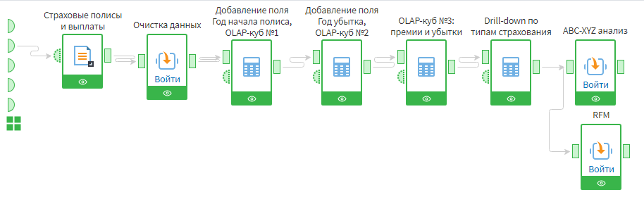
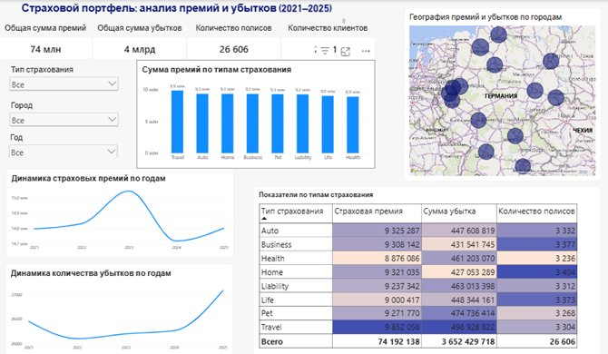
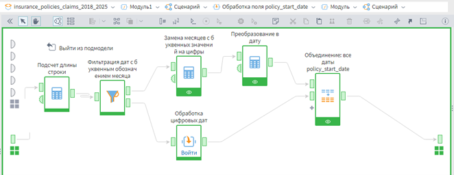
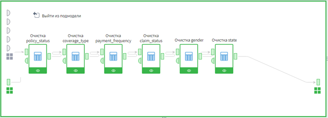
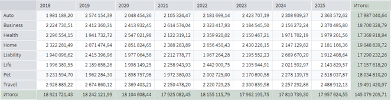
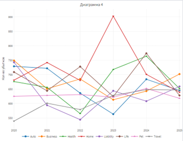
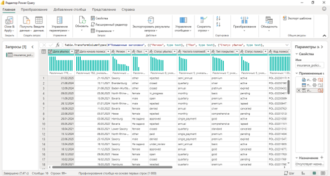

# Страховая аналитика: полный цикл от очистки данных до BI-дашборда

**Стек:** Loginom (Low-code ETL + OLAP) · Power BI · CSV  
**Данные:** синтетический датасет страховых полисов и убытков немецких страховых компаний, 2018–2025  
**Объём:** 52 676 строк × 76 признаков (исходно) → 51 327 строк × 16 полей (после очистки)

## 🗺️ Общая карта проекта

Общий сценарий в Loginom (все этапы: очистка → OLAP → Drill-down → ABC-XYZ → RFM):

Итоговый интерактивный дашборд в Power BI:

---

## 🎯 Задача

Пройти полный аналитический цикл на «грязных» данных: от импорта и очистки в Loginom до многомерного анализа и интерактивного дашборда в Power BI. Датасет выбран намеренно — в нём есть пропуски, дубликаты, смешанные форматы дат и несогласованные текстовые категории, то есть всё, что встречается в реальных источниках.

## 🧹 Этап 1. Очистка данных (Loginom)

- **Дубликаты:** 1 349 полных дубликатов удалено по ключу `policy_id` → 51 327 строк.
- **Даты:** `policy_start_date` и `claim_date` содержали смешанные форматы (`07/30/2019`, `28-12-20`, `2023/10/06`, текстовые месяцы). Построена двухветочная логика: текстовые месяцы → числовые, унификация разделителей, определение позиции года, для неоднозначных случаев принят европейский формат `ДД.ММ.ГГГГ` (обосновано страновой принадлежностью данных). **Итог: 0 пропусков, 100% дат приведены к типу «Дата/время».**

Схема обработки поля `policy_start_date`:

*Общая схема обработки:*

*Подмодель «Обработка цифровых дат»:*

*Подмодель «Преобразование в дату: год в конце»:*

*Поле `claim_date` обработано аналогично.*

- **Текстовые поля:** стандартизированы регистр, сокращения и немецко-английские дубли (`Bayern → Bavaria`, `Sachsen → Saxony` и т.д.); `policy_status`: 11 → 5 значений, `state`: 13 → 10 значений.

- **Пропуски:** проанализированы (большинство — естественная структура страховых данных), в поле `gender` заполнены значением «Не задано» для использования как измерения.
- **Выбросы:** выявлены единичные отрицательные значения (0,21% премий, 0,07% убытков) — оставлены как технические корректировки.

## 📊 Этап 2. OLAP-анализ (Loginom)

- **Куб 1:** сумма премий по типам страхования и годам — портфель диверсифицирован (все 8 типов в диапазоне 17–19 млн € за 8 лет).

- **Куб 2:** оплаченные убытки по годам и типам (со срезом `claim_status = paid`), pivot для наглядности.

- **Куб 3:** сравнение средних премий и выплат — выявлены экстремальные выбросы (отдельные выплаты до 45 млн €).

- **Drill-down / drill-up:** иерархия «Тип страхования → Год убытка». Лидер по убыткам — **Auto (942,1 млн € за 2020–2025)**.

## 🧩 Этап 3. Дополнительная аналитика

- **ABC-анализ:** A — 52,5% клиентов (80% выручки), B — 23,5%, C — 24,0%.
- **XYZ-анализ:** 99,98% клиентов — класс X (стабильные).
- **ABC-XYZ матрица:** AX — 26 187 клиентов, AZ — 9 клиентов.
- **RFM (адаптированный):** 47,5% — сегмент 311 (безаварийные, малопремиальные), «идеальных» 333 — всего 12 клиентов.

Настройка компонентов ABC/XYZ:

Настройка компонентов RFM:

> ⚠️ Данные синтетические — результаты демонстрируют **методику**, а не реальную картину рынка.

## 📈 Этап 4. Дашборд Power BI

Дашборд на данных за **2021–2025 гг.** (26 606 строк, 16 полей):
- 4 KPI-карточки: премии ≈ 74,2 млн €, убытки ≈ 3,65 млрд €, 26 606 полисов, 26 218 клиентов;
- срезы: тип страхования, город, год;
- гистограмма премий по типам, два графика динамики (премии и количество убытков);
- карта 14 городов Германии, сводная таблица с градиентной заливкой.

В процессе работы были созданы пользовательские **меры на языке DAX** для корректного расчета ключевых показателей:
- `Количество полисов` = `DISTINCTCOUNT('insurance_policies_claims_2018_2025_clean'[policy_id])`
- `Количество клиентов` = `DISTINCTCOUNT('insurance_policies_claims_2018_2025_clean'[customer_id])`

Проверка типов данных в Power Query:

Итоговый вид дашборда:

### Ключевые выводы

1. Портфель сбалансирован: все 8 типов дают 8,6–9,5 млн € за 5 лет.
2. **Travel** — лидер и по премиям (9,55 млн €), и по убыткам (498,9 млн €): потенциально рискованный продукт.
3. Тревожный тренд: премии росли до 2023 г., затем снижаются, а количество убытков устойчиво растёт с 2022 г.
4. География сконцентрирована в 14 крупных городах (Берлин, Кёльн, Дрезден).
5. Выбросы по убыткам (до 45 млн €) искажают средние — в реальной практике нужна предварительная фильтрация.

## 📁 Структура репозитория

| Папка | Содержимое |
|---|---|
| `data/` | исходный и очищенный датасеты |
| `loginom/` | сценарий очистки и OLAP (`.lgp`) |
| `powerbi/` | интерактивный дашборд (`.pbix`) |
| `screenshots/` | скриншоты ключевых этапов |

## 🔗 Источник данных

[Kaggle: Insurance Policies & Claims 2018–2025](https://www.kaggle.com/datasets/danielsowah123/insurance?select=insurance_policies_claims_2018_2025.csv)

## ⚠️ Оговорка

Датасет синтетический, создан для учебных целей. Проект демонстрирует **методологию полного цикла аналитики** (ETL → OLAP → ABC-XYZ-RFM → BI), а не бизнес-выводы о реальном страховом рынке.
