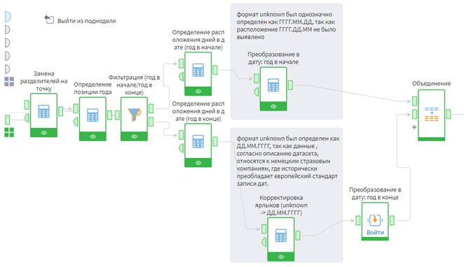
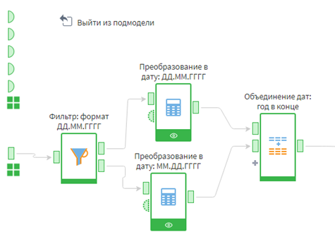
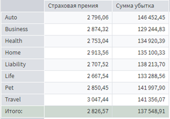
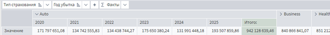
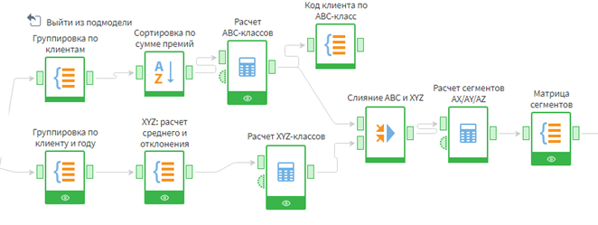
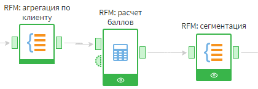
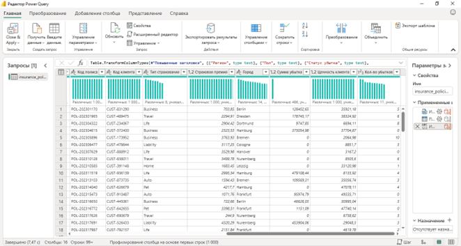

# Страховая аналитика: полный цикл от очистки данных до BI-дашборда

**Стек:** Loginom (Low-code ETL + OLAP + ABC-XYZ + RFM) · Power BI · **SQL / DuckDB (оконные функции)** · CSV  
**Данные:** синтетический датасет страховых полисов и убытков немецких страховых компаний, 2018–2025  
**Объём:** 52 676 строк × 76 признаков (исходно) → 51 327 строк × 16 полей (после очистки)

## 🗺️ Общая карта проекта

Общий сценарий в Loginom (все этапы: очистка → OLAP → Drill-down → ABC-XYZ → RFM):

Итоговый интерактивный дашборд в Power BI:

SQL-углубление по продукту Travel (оконные функции) — [`sql/travel_deep_dive.sql`](sql/travel_deep_dive.sql):

---

## 🎯 Задача

Пройти полный аналитический цикл на «грязных» данных: от импорта и очистки в Loginom до многомерного анализа и интерактивного дашборда в Power BI. Датасет выбран намеренно — в нём есть пропуски, дубликаты, смешанные форматы дат и несогласованные текстовые категории, то есть всё, что встречается в реальных источниках.

## 🧹 Этап 1. Очистка данных (Loginom)

- **Дубликаты:** 1 349 полных дубликатов удалено по ключу `policy_id` → 51 327 строк.
- **Даты:** `policy_start_date` и `claim_date` содержали смешанные форматы (`07/30/2019`, `28-12-20`, `2023/10/06`, текстовые месяцы). Построена двухветочная логика: текстовые месяцы → числовые, унификация разделителей, определение позиции года, для неоднозначных случаев принят европейский формат `ДД.ММ.ГГГГ` (обосновано страновой принадлежностью данных). **Итог: 0 пропусков, 100% дат приведены к типу «Дата/время».**

Схема обработки поля `policy_start_date`:

*Общая схема обработки:*

*Подмодель «Обработка цифровых дат»:*

*Подмодель «Преобразование в дату: год в конце»:*

*Поле `claim_date` обработано аналогично.*

- **Текстовые поля:** стандартизированы регистр, сокращения и немецко-английские дубли (`Bayern → Bavaria`, `Sachsen → Saxony` и т.д.); `policy_status`: 11 → 5 значений, `state`: 13 → 10 значений.

- **Пропуски:** проанализированы (большинство — естественная структура страховых данных), в поле `gender` заполнены значением «Не задано» для использования как измерения.
- **Выбросы:** выявлены единичные отрицательные значения (0,21% премий, 0,07% убытков) — оставлены как технические корректировки.

## 📊 Этап 2. OLAP-анализ (Loginom)

- **Куб 1:** сумма премий по типам страхования и годам — портфель диверсифицирован (все 8 типов в диапазоне 17–19 млн € за 8 лет).

- **Куб 2:** оплаченные убытки по годам и типам (со срезом `claim_status = paid`), pivot для наглядности.

- **Куб 3:** сравнение средних премий и выплат — выявлены экстремальные выбросы (отдельные выплаты до 45 млн €).

- **Drill-down / drill-up:** иерархия «Тип страхования → Год убытка». Лидер по убыткам — **Auto (942,1 млн € за 2020–2025)**.

## 🧩 Этап 3. Дополнительная аналитика

- **ABC-анализ:** A — 52,5% клиентов (80% выручки), B — 23,5%, C — 24,0%.
- **XYZ-анализ:** 99,98% клиентов — класс X (стабильные).
- **ABC-XYZ матрица:** AX — 26 187 клиентов, AZ — 9 клиентов.
- **RFM (адаптированный):** 47,5% — сегмент 311 (безаварийные, малопремиальные), «идеальных» 333 — всего 12 клиентов.

Настройка компонентов ABC/XYZ:

Настройка компонентов RFM:

## 📈 Этап 4. Дашборд Power BI

Дашборд на данных за **2021–2025 гг.** (26 606 строк, 16 полей):
- 4 KPI-карточки: премии ≈ 74,2 млн €, убытки ≈ 3,65 млрд €, 26 606 полисов, 26 218 клиентов;
- срезы: тип страхования, город, год;
- гистограмма премий по типам, два графика динамики (премии и количество убытков);
- карта 14 городов Германии, сводная таблица с градиентной заливкой.

В процессе работы были созданы пользовательские **меры на языке DAX** для корректного расчета ключевых показателей:
- `Количество полисов` = `DISTINCTCOUNT('insurance_policies_claims_2018_2025_clean'[policy_id])`
- `Количество клиентов` = `DISTINCTCOUNT('insurance_policies_claims_2018_2025_clean'[customer_id])`

Проверка типов данных в Power Query:

Итоговый вид дашборда:

### Ключевые выводы

1. Портфель сбалансирован: все 8 типов дают 8,6–9,5 млн € за 5 лет.
2. **Travel** — лидер и по премиям (9,55 млн €), и по убыткам (498,9 млн €): потенциально рискованный продукт. Углублённый анализ — в разделе «🔍 Углублённый анализ: продукт Travel».
3. Тревожный тренд: премии росли до 2023 г., затем снижаются, а количество убытков устойчиво растёт с 2022 г.
4. География сконцентрирована в 14 крупных городах (Берлин, Кёльн, Дрезден).
5. Выбросы по убыткам (до 45 млн €) искажают средние — в реальной практике нужна предварительная фильтрация.

## 🔍 Углублённый анализ: продукт Travel

Travel — лидер и по премиям (9,55 млн €), и по убыткам (498,9 млн €). Ниже — 4 SQL-запроса с оконными функциями (DuckDB), которые показывают динамику, географию, концентрацию и убыточность внутри этого продукта. SQL-код приведён под спойлерами; полный файл — [`sql/travel_deep_dive.sql`](sql/travel_deep_dive.sql).

**Запрос 1. Доля Travel в общих премиях по годам** — обычная группировка (`GROUP BY`)

Показать SQL

    SELECT
      year("Дата начала полиса") AS policy_year,
      SUM(CASE WHEN "Тип страхования" = 'Travel' THEN "Страховая премия" ELSE 0 END) AS travel_premium,
      SUM("Страховая премия") AS total_premium,
      ROUND(
        100.0 * SUM(CASE WHEN "Тип страхования" = 'Travel' THEN "Страховая премия" ELSE 0 END)
              / SUM("Страховая премия"),
        2
      ) AS travel_share_pct
    FROM insurance_clean
    GROUP BY policy_year
    ORDER BY policy_year;

| Год | Премии Travel, € | Все премии, € | Доля Travel, % |
|---|---|---|---|
| 2021 | 1 953 461 | 14 796 984 | 13,20 |
| 2022 | 1 921 855 | 14 830 755 | 12,96 |
| 2023 | 1 960 696 | 15 044 875 | 13,03 |
| 2024 | 1 839 172 | 14 717 665 | 12,50 |
| 2025 | 2 176 875 | 14 801 859 | 14,71 |

**Вывод:** доля Travel в премиях стабильна (~13%) на протяжении 2021–2025, с минимумом 12,5% в 2024 и максимумом 14,71% в 2025. Портфель сбалансирован: Travel не вытесняет другие продукты, но и не растёт относительно них. Значит, проблема Travel — не в объёме премий, а в убыточности.

**Запрос 2. YoY-прирост премий и убытков внутри Travel** — оконная функция `LAG()`

Показать SQL

    WITH yearly AS (
      SELECT
        year("Дата начала полиса") AS policy_year,
        ROUND(SUM("Страховая премия"), 2) AS premium,
        ROUND(SUM(CASE WHEN "Статус убытка" = 'paid' THEN "Сумма убытка" ELSE 0 END), 2) AS claims
      FROM insurance_clean
      WHERE "Тип страхования" = 'Travel'
      GROUP BY policy_year
    )
    SELECT
      policy_year,
      premium,
      claims,
      ROUND(100.0 * (premium - LAG(premium) OVER (ORDER BY policy_year))
            / LAG(premium) OVER (ORDER BY policy_year), 2) AS premium_yoy_pct,
      ROUND(100.0 * (claims - LAG(claims) OVER (ORDER BY policy_year))
            / LAG(claims) OVER (ORDER BY policy_year), 2) AS claims_yoy_pct
    FROM yearly
    ORDER BY policy_year;

| Год | Премии, € | Убытки (paid), € | Прирост премий, % | Прирост убытков, % |
|---|---|---|---|---|
| 2021 | 1 953 460,63 | 8 763 397,34 | — | — |
| 2022 | 1 921 854,58 | 6 778 973,53 | −1,62 | −22,64 |
| 2023 | 1 960 695,97 | 11 743 829,05 | +2,02 | **+73,24** |
| 2024 | 1 839 171,65 | 8 315 427,96 | −6,20 | −29,19 |
| 2025 | 2 176 875,05 | 7 102 385,34 | +18,36 | −14,59 |

**Вывод:** внутри Travel премии стабильны (колебания в пределах ±18%), а убытки крайне волатильны: в 2023 они выросли на 73,2% при росте премий всего на 2,0%. Убытки стабильно в 3–4 раза превышают премии (2025: 7,10 млн € против 2,18 млн €). Travel — не проблема объёма, а проблема убыточности и её скачков.

**Запрос 3. Топ-3 города по премиям Travel в каждом году** — оконная функция `RANK()`

Показать SQL

    WITH city_premium AS (
      SELECT
        year("Дата начала полиса") AS policy_year,
        "Город" AS city,
        ROUND(SUM("Страховая премия"), 2) AS premium
      FROM insurance_clean
      WHERE "Тип страхования" = 'Travel'
      GROUP BY policy_year, "Город"
    ),
    ranked AS (
      SELECT
        policy_year,
        city,
        premium,
        RANK() OVER (PARTITION BY policy_year ORDER BY premium DESC) AS city_rank
      FROM city_premium
    )
    SELECT *
    FROM ranked
    WHERE city_rank <= 3
    ORDER BY policy_year, city_rank;

| Год | 1-е место | 2-е место | 3-е место |
|---|---|---|---|
| 2021 | Bremen (272 644 €) | Hanover (251 142 €) | Essen (173 886 €) |
| 2022 | Bremen (341 006 €) | Frankfurt (159 144 €) | Essen (156 479 €) |
| 2023 | Hamburg (416 059 €) | Dresden (196 524 €) | Munich (144 050 €) |
| 2024 | Cologne (227 945 €) | Hamburg (186 331 €) | Bremen (171 419 €) |
| 2025 | Bremen (457 652 €) | Munich (222 110 €) | Berlin (217 982 €) |

**Вывод:** топ-3 городов по премиям Travel нестабилен: единственный «якорь» — Bremen (1-е место в 2021, 2022, 2025). Hamburg даёт разовый всплеск в 2023–2024, Essen — в 2021–2022. Это говорит о высокой концентрации Travel в отдельных городах и о том, что география продукта «переезжает» год от года — в отличие от сбалансированного портфеля в целом.

**Запрос 4. ABC-анализ клиентов внутри Travel** — кумулятивная доля (`SUM() OVER`)

Показать SQL

    WITH client_premium AS (
      SELECT
        "Код клиента" AS customer_id,
        ROUND(SUM("Страховая премия"), 2) AS premium
      FROM insurance_clean
      WHERE "Тип страхования" = 'Travel'
      GROUP BY "Код клиента"
    ),
    ranked AS (
      SELECT
        customer_id,
        premium,
        SUM(premium) OVER (ORDER BY premium DESC) AS cum_premium,
        SUM(premium) OVER () AS total_premium
      FROM client_premium
    )
    SELECT
      COUNT(*) AS total_clients,
      SUM(CASE WHEN cum_premium / total_premium <= 0.80 THEN 1 ELSE 0 END) AS clients_A,
      SUM(CASE WHEN cum_premium / total_premium > 0.80
                AND cum_premium / total_premium <= 0.95 THEN 1 ELSE 0 END) AS clients_B,
      SUM(CASE WHEN cum_premium / total_premium > 0.95 THEN 1 ELSE 0 END) AS clients_C,
      ROUND(100.0 * SUM(CASE WHEN cum_premium / total_premium <= 0.80 THEN 1 ELSE 0 END) / COUNT(*), 2) AS share_A_pct
    FROM ranked;

| Класс | Клиентов | Доля клиентов, % | Доля премий, % |
|---|---|---|---|
| A | 1 681 | 50,97 | 80 |
| B | 806 | 24,44 | 15 |
| C | 811 | 24,59 | 5 |

**Вывод:** 80% премий Travel дают 50,97% клиентов (1 681 из 3 298) — почти как по всему портфелю (A — 52,5% клиентов). Travel не выделяется аномальной концентрацией: он устроен так же, как портфель в целом. Значит, проблема Travel — не в «нескольких крупных клиентах», а в убыточности (см. запрос 2). Это также подтверждает корректность ABC-компонента в Loginom: ручной SQL-расчёт даёт тот же порядок цифр.

**Итог по Travel:** продукт стабилен по объёму премий и концентрации клиентов, но убыточен и волатилен по выплатам. Основной риск — не «пара крупных клиентов» и не «вытеснение другими продуктами», а **скачки убытков** (2023: +73,2%) и устойчивое превышение выплат над премиями в 3–4 раза.

## 📁 Структура репозитория

| Папка | Содержимое |
|---|---|
| `data/` | исходный и очищенный датасеты |
| `loginom/` | сценарий очистки и OLAP (`.lgp`) |
| `powerbi/` | интерактивный дашборд (`.pbix`) |
| `sql/` | SQL-запросы с оконными функциями (DuckDB), углублённый анализ Travel |
| `screenshots/` | скриншоты ключевых этапов |

## 🔗 Источник данных

[Kaggle: Insurance Policies & Claims 2018–2025](https://www.kaggle.com/datasets/danielsowah123/insurance?select=insurance_policies_claims_2018_2025.csv)

## ⚠️ Оговорка

Датасет синтетический, создан для учебных целей. Проект демонстрирует **методологию полного цикла аналитики** (ETL → OLAP → ABC-XYZ-RFM → BI), а не бизнес-выводы о реальном страховом рынке. SQL-блок (`sql/travel_deep_dive.sql`) выполнен в DuckDB на очищенном датасете; результаты сверены с ABC-анализом в Loginom.
